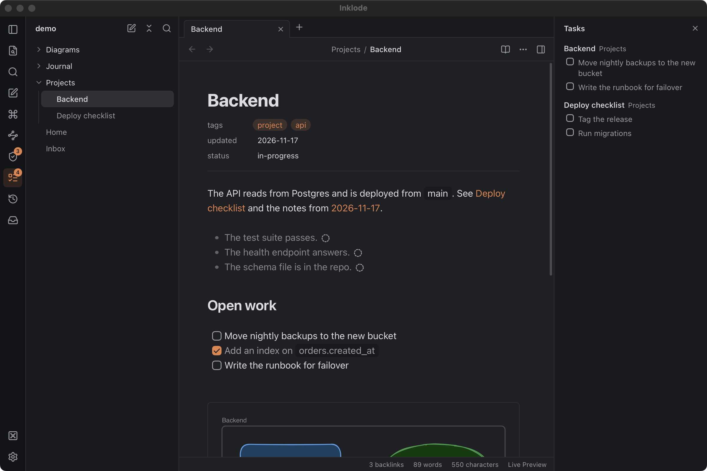

# Inklode

Inklode is a local-first desktop Markdown notes app that works on a plain folder of `.md` files, the same folder Obsidian can open. It is built for notes that AI agents also read and write: it has an MCP server, shows who changed what through git, and holds changes made outside the app in a review inbox until you accept or reject them. A line of a note can carry its evidence (a command, a file or a URL), which the app runs again when you click, so a statement in a note can be checked instead of believed.

Why it exists: once agents edit your notes, the questions become "what did it change" and "is this still true". Inklode answers the first from git and the second from claims, and keeps the notes as ordinary files that every other tool can still use.

**Status:** version 0.1.0, early, written by one author. macOS on Apple Silicon is the only tested platform; Windows and Linux are untested. A signed build for Apple Silicon is on the [releases page](https://github.com/AlinScreciu/inklode/releases/latest) and updates itself; on anything else you build it from source.



Built with Tauri 2, a Rust core and a React UI on CodeMirror 6.

## Security

Read this before you open a vault you did not write, or switch the MCP server on.

- **The MCP server in the app is off by default.** When it is on, it listens on `127.0.0.1` only and refuses requests that come from a web page (any request with an `Origin` header, or a `Host` other than `127.0.0.1:<port>` or `localhost:<port>`). Every request must carry a token (`Authorization: Bearer <token>`), which the app keeps in a file in its own config folder that only your user can read. A client that has the token can read and write the open vault, drive the window (click, type, run commands of the app), and open any folder as a vault, so it reaches every file your user can. Any program running as your user can read the token file. The setting is stored in the app's own config folder, so a vault cannot switch it on.
- **Claim commands run shell commands taken from note text.** They run only when you click Check in the app, and only in a vault you marked as trusted in Settings. The check for trust is made in the Rust shell, not in the window, and no MCP tool can check a claim or trust a vault. But an agent or program that can write notes can change the command of a claim in a trusted vault, and that command then runs as you the next time you check that claim. Read the command before you check it. Trust goes by the folder's path.
- **URL claims send a request from your machine**, also in a vault that is not trusted, and also to addresses only your machine can reach. Again only on your click.
- **Remote images in notes load from the network.** A note with `` makes the app fetch that URL when the note is shown, which tells the server that you opened it.
- **Git is run with a hostile repository in mind.** History, review and health read the vault's repository, and the repositories a note's `repos:` names, by running `git`. Every call switches off what a repository's config can make git run or fetch (filters, diff drivers, hooks, signature programs, pagers, remotes), and git is never asked to read a note from disk: the app compares committed text with the file itself. A bare repository is not read.
- **The app is not sandboxed.** It runs with your user's rights, without the macOS App Sandbox. The window has a content security policy: scripts, fonts and connections from the app itself only, no frames, images from the vault and over https. A vault's themes and snippets (`.inklode/themes`, `.inklode/snippets`) are CSS that the app loads when the vault opens, and CSS can restyle or hide any part of the window. A symlink in a vault that leads out of the vault, or to a dot folder, is left out of the tree and refused; one that leads to a place in the vault works as that place.
- **The app checks for updates when it starts.** With "Check for updates when Inklode starts" on (Settings, About; on by default), the app contacts github.com once per start to read the latest version. Nothing about you or your vault is sent. An update is downloaded and installed only when you press "Install and restart", and it is verified against a public key built into the app before it is installed.
- Builds from source are not signed or notarized.

To report a vulnerability, see [SECURITY.md](SECURITY.md). The details of the claims trust model are in [docs/claims.md](docs/claims.md), those of the MCP server in [docs/mcp.md](docs/mcp.md).

## Features

### Core

- Opens any folder of `.md` files as a vault. Notes stay plain files; the app keeps its own files in `.inklode/` inside the vault and leaves other dot folders (`.git`, `.obsidian`) alone.
- Editor with Live Preview and a source mode (`Mod+E`), on CodeMirror 6: GitHub-flavoured Markdown, frontmatter shown as a properties block, images, task checkboxes, find and replace in a note (`Mod+F`). `Mod` is Cmd on macOS and Ctrl elsewhere.
- `[[Wikilinks]]` with aliases and heading links, backlinks, and renames that rewrite the links that point to the moved note or folder.
- File tree, tabs, split panes, an outline, back and forward.
- Quick switcher (`Mod+O`), command palette (`Mod+P`), search in all notes (`Mod+Shift+F`).
- Saving never writes over a text the app has not seen: when a file changed on disk under an unsaved edit, the app asks (keep mine, take theirs, show both). Deleting moves to `.trash/` in the vault.
- Per-vault themes and CSS snippets, four built-in themes, light and dark, and keys that can be rebound. See [docs/settings.md](docs/settings.md) and [docs/themes.md](docs/themes.md).

### Modules

Everything beyond the base app is a module that can be switched on or off per vault, in Settings (`Mod+,`) under "Modules", or with `"modules": {"<id>": true}` in the vault's `.inklode/settings.json`. A module that is off is not loaded. Three are on by default; the rest are off until you switch them on.

| Module | Id | Default | What it adds |
|---|---|---|---|
| Excalidraw drawings | `excalidraw` | on | `<name>.excalidraw.md` files open in an Excalidraw canvas, in the Obsidian Excalidraw plugin's uncompressed format, and can be embedded in notes and presented as slides. |
| Graph view | `graph` | on | Every note as a dot and every link as a line (`Mod+G`), and a local graph of the active note in the right sidebar, both with filters, colour groups and layout options. |
| Tables | `tables` | on | Pipe tables shown and edited as tables in Live Preview. |
| Git history | `history` | off | A note's commits, a comparison with any version, restore, and a blame margin. Git is only read. |
| Merge | `merge` | off | A three-way merge when a note changed on disk under an unsaved edit and the two changes are in different parts of the note. |
| Review | `review` | off | An inbox of the notes that changed since you last looked, whoever changed them, with accept and reject per note. |
| Vault health | `health` | off | Broken links, notes without links, and notes that are stale against the code repositories they name. |
| Tasks | `tasks` | off | Every open checkbox of the vault in one panel, with ticking. |
| Quick capture | `capture` | off | A system-wide hotkey that appends a line to a capture note. |
| Claims | `claims` | off | Lines that carry their evidence, a status mark for each, and a queue of the ones that fail or went stale. |

The reference for each module (commands, `ui_state` entries, known limits) is in [docs/modules.md](docs/modules.md), and for claims in [docs/claims.md](docs/claims.md).

### Claims in one example

```markdown
45 core tests pass. <!-- check: cargo test -p core @ ~/code/myproject -->
The spec is in the vault. <!-- check: file Notes/Spec.md -->
Docs are online. <!-- check: https://tauri.app -->
```

The comment at the end of the line is the evidence. The rendered note shows a status mark in its place: passing, failing, stale (the last pass is older than 30 days, or the file changed) or unchecked. Nothing runs until you click Check. Results are kept outside the vault, so a check never shows up in git.

## Build from source

Prerequisites, with the versions this was built and tested with:

- Rust 1.100.0 (stable). The crates use edition 2024, which needs Rust 1.85 or newer.
- Node.js 24.10. The UI self-checks import `.ts` files directly, so they need a Node that strips types on import without a flag.
- pnpm 12.21 (the lockfile is version 9.0; pnpm 10 reads it too).
- On macOS, the Xcode Command Line Tools. For other systems see the [Tauri prerequisites](https://tauri.app/start/prerequisites/); those platforms are untested.
- Optional at run time: `git` on the `PATH` for the history, review and health modules.

```sh
pnpm install
pnpm tauri dev                  # the desktop app, with hot reload
pnpm tauri build --bundles app  # a release build: target/release/bundle/macos/Inklode.app
```

Releases are signed and notarized by a workflow; [docs/releasing.md](docs/releasing.md) has the steps.

An app built this way still looks for updates from this repository's releases. A build under `pnpm tauri dev` never checks by itself.

`pnpm dev` alone serves the UI in a browser at `http://localhost:1420` on an in-memory demo vault, without the desktop shell.

## Use it with Claude Code or another MCP client

There are two servers; [docs/mcp.md](docs/mcp.md) lists the tools of both.

**Headless, over stdio, for one vault.** The app does not need to run. The released app carries the binary; register it:

```sh
claude mcp add inklode -- /Applications/Inklode.app/Contents/MacOS/inklode-mcp --vault /absolute/path/to/vault
```

From a clone, build it with `cargo build --release -p inklode-mcp` and name `target/release/inklode-mcp` instead.

Another MCP client takes the same command line: the binary, then `--vault` and the vault's absolute path. Its tools read, search, write, create, rename and delete notes, and read backlinks, git history, the review inbox, vault health, open tasks and claims.

**Inside the running app, over HTTP.** It offers the same tools on the vault open in the window, plus tools to run the app's commands, read what the window shows, click, type and take a screenshot. Switch it on in Settings (`Mod+,`) under "MCP server" (default port 7811), then:

```sh
claude mcp add --transport http inklode-app http://127.0.0.1:7811/mcp --header "Authorization: Bearer <token>"
```

Settings has a "Copy" button for this line with the token filled in, one for the token alone, and "New token", which replaces it. Read the [Security](#security) section first: a client with the token can open any folder as a vault.

With the `review` module on, what an agent changes through either server, or by writing files, waits in the review inbox.

## Tests

```sh
cargo test --workspace   # core, MCP tools, the stdio server, the shell
pnpm build               # type-check and build the UI
```

The pure logic of the UI has self-checks that run in plain Node, one script per area: `pnpm test:capture`, `test:claims`, `test:excalidraw`, `test:frontmatter`, `test:history`, `test:merge`, `test:review`, `test:shell`, `test:tables`, `test:tasks` and `test:themes`. CI runs all of them ([.github/workflows/ci.yml](.github/workflows/ci.yml)).

## Layout

| Path | What |
|---|---|
| `crates/core` | Vault logic in Rust. No UI and no Tauri dependency. Every operation goes through `Core::call(name, params)` in `src/call.rs`. |
| `crates/mcp` | The MCP tools over a vault: each row of the `TOOLS` table in `src/lib.rs` maps to one `Core::call`. `src/main.rs` is `inklode-mcp`, the headless server over stdio. |
| `src-tauri` | The desktop shell. The command `core_call` forwards to the core. `src/mcp.rs` is the in-app MCP server: the same `TOOLS`, plus tools the window answers through `ui-request` events and the `ui_reply` command. |
| `src` | The React UI. `core/client.ts` is the only file that talks to the shell. `commands.ts` is the command registry behind the palette and shortcuts. `config.ts` reads and writes the vault's `.inklode` folder. `modules.ts` is the module registry, and `modules/` has one folder per module. |
| `docs` | Reference: [modules](docs/modules.md), [claims](docs/claims.md), [MCP](docs/mcp.md), [settings](docs/settings.md), [themes](docs/themes.md), [slideshow format](docs/slideshow-spec.md). |

Adding things:

- A core operation: add a match arm and a row in the table on `Core::call`, and the same case in `src/core/mock.ts`. To offer it over MCP too, add a row to `TOOLS` in `crates/mcp/src/lib.rs`.
- A UI action: register a command (see `App.tsx`). It then shows in the palette and gets its shortcut.
- A module: see "How modules work" in [docs/modules.md](docs/modules.md#how-modules-work).
- Colours, fonts and sizes are CSS variables at the top of `src/app.css`.

[CONTRIBUTING.md](CONTRIBUTING.md) has the rules for changes, and [AGENTS.md](AGENTS.md) the instructions for AI coding agents.

## Roadmap and limits

Planned and not started:

- Sync between devices.
- A phone app.
- Semantic search. Search today is a case-insensitive substring match over file names and note lines, with at most 200 hits.

Known limits of this version:

- Tested on macOS on Apple Silicon only. `ui_screenshot` and the capture box's panel are macOS-only code; the rest is meant to be portable and was not tried elsewhere.
- The prebuilt app is for Apple Silicon Macs only.
- The index keeps every note's text in memory and rescans the vault after a change, which is fine for a few thousand notes.
- `![[note]]` shows as a link, not as the note's content.
- A client of the MCP server in the app can open any folder as a vault (see [Security](#security)).
- Each module lists its own known limits in [docs/modules.md](docs/modules.md) and [docs/claims.md](docs/claims.md).

## Licence

MIT, see [LICENSE](LICENSE). Notices for the work Inklode ships or derives from (Lucide icons, the Catppuccin and Minimal themes) and for the file formats it reads (the Obsidian Excalidraw plugin's, whose code is not used) are in [THIRD-PARTY-NOTICES.md](THIRD-PARTY-NOTICES.md).
